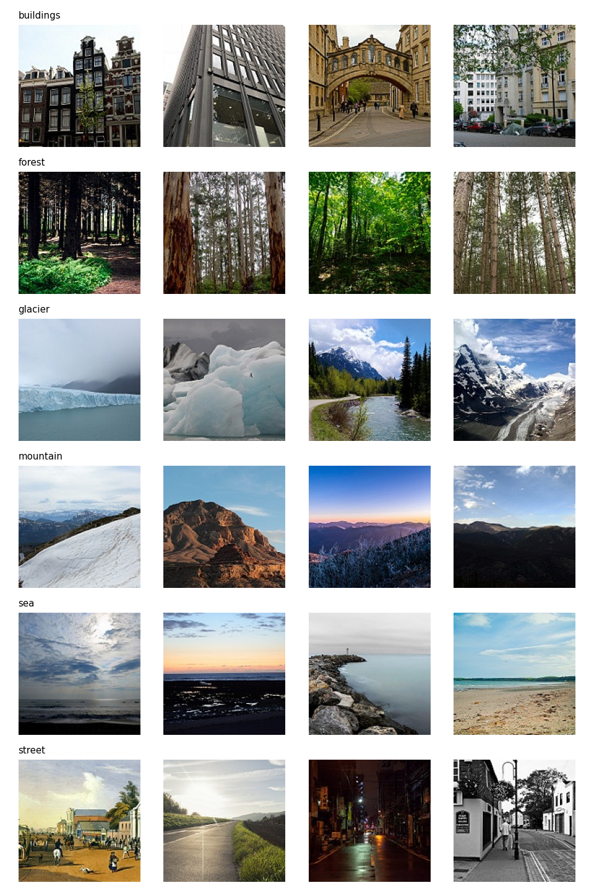
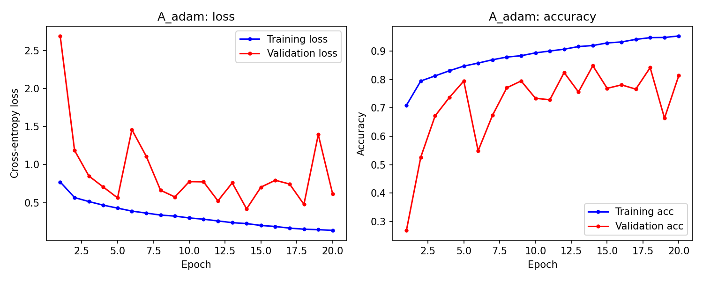
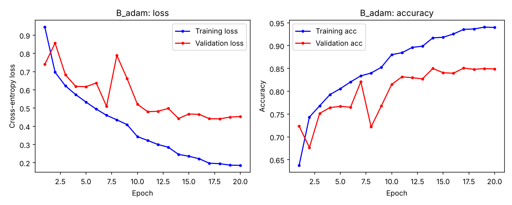

# Edge Image Classification

Lightweight CNN-based image classification designed for efficient deployment on resource-constrained edge devices.

The project compares a standard CNN, a sub-100k-parameter CNN built from depthwise separable convolutions, and fine-tuned pretrained networks (MobileNetV2, EfficientNetB0). It reports accuracy, model size, parameter count and training time for each. EN3150 Assignment 03.



## Dataset

[Intel Image Classification](https://www.kaggle.com/datasets/puneet6060/intel-image-classification) contains natural scene images (mostly 150×150 RGB) in 6 classes: `buildings`, `forest`, `glacier`, `mountain`, `sea`, `street`.

The Kaggle `seg_train` and `seg_test` folders are merged and re-split per class into **70% train / 15% validation / 15% test** (seed 42):

| Subset | Images |
|---|---|
| Train | 11,920 |
| Validation | 2,552 |
| Test | 2,562 |

The split is stored in [`results/split.csv`](results/split.csv), so every model uses exactly the same images. All images are resized to **64×64** and scaled to [0, 1].

The dataset is not included in this repository. Download it from Kaggle and extract it so the layout is:

```
data/
├── seg_train/seg_train/<class>/*.jpg
└── seg_test/seg_test/<class>/*.jpg
```

## Models

| Model | Description | Trainable params |
|---|---|---|
| **A** (standard) | 4 × [Conv2D 3×3 → BatchNorm → ReLU → MaxPool], filters 32/64/128/128, then GlobalAvgPool → Dense(64) → Dense(6, softmax) | 250,182 |
| **B** (lightweight) | Same layout as A with every Conv2D replaced by `SeparableConv2D` (3×3 depthwise + 1×1 pointwise) | 38,113 |
| **MobileNetV2** | ImageNet-pretrained backbone + GlobalAvgPool → Dropout(0.2) → Dense(6) | — |
| **EfficientNetB0** | ImageNet-pretrained backbone + GlobalAvgPool → Dropout(0.2) → Dense(6) | — |

Model B stays well under the 100,000-parameter limit. Global average pooling replaces a large flatten + dense layer in both custom models.

## Project structure

```
Edge-Image-Classification/
├── data/                 # dataset (not tracked)
├── models/               # saved checkpoints (not tracked)
├── plots/                # training curves, confusion matrices, sample grid
├── results/              # split manifest, training histories, metrics
└── src/
    ├── check_data.py     # count images per class and split
    ├── check_sizes.py    # list image sizes and colour modes
    ├── view_samples.py   # save a grid of sample images per class
    ├── split_data.py     # build the 70/15/15 split -> results/split.csv
    ├── data.py           # tf.data pipeline (load, resize, normalise, batch)
    ├── modelA.py         # Model A: standard CNN
    ├── modelB.py         # Model B: depthwise separable CNN
    ├── train.py          # train Model A or B with a chosen optimizer
    ├── sota.py           # fine-tune MobileNetV2 / EfficientNetB0
    └── plot_utils.py     # training-curve plotting helper
```

## Setup

Requires Python 3.10+.

```bash
python -m venv .venv
# Windows: .venv\Scripts\activate    Linux/macOS: source .venv/bin/activate
pip install tensorflow numpy matplotlib pillow
mkdir models
```

Run all scripts **from the repository root**, because paths such as `data/`, `results/` and `models/` are relative.

## Usage

**1. Inspect the data (optional)**

```bash
python src/check_data.py
python src/check_sizes.py
python src/view_samples.py
```

**2. Create the train/val/test split**

```bash
python src/split_data.py
```

**3. Check the models and the pipeline (optional)**

```bash
python src/modelA.py      # prints the summary
python src/modelB.py      # prints the summary and checks the 100k limit
python src/data.py        # prints one batch's shape and value range
```

**4. Train the custom models**

```bash
python src/train.py <A|B> <adam|sgd|sgd_momentum>
# e.g.
python src/train.py A adam
python src/train.py B sgd_momentum
```

- 20 epochs by default (pass a third argument to change it, e.g. `python src/train.py A adam 30`), batch size 32.
- Learning rate 0.001 for Adam and 0.01 for SGD; `sgd_momentum` uses momentum 0.9. `ReduceLROnPlateau` halves the learning rate when validation loss has not improved for 2 epochs.
- BatchNorm layers use momentum 0.9 so the statistics used for validation track the weights closely.
- The checkpoint with the best validation loss is saved to `models/<model>_<optimizer>.keras`.
- History and epoch times go to `results/<model>_<optimizer>_history.json`.
- Loss and accuracy curves go to `plots/<model>_<optimizer>_curves.png`.

**5. Fine-tune pretrained models**

```bash
python src/sota.py mobilenetv2
python src/sota.py efficientnetb0
```

**6. Evaluate on the test set and build the comparison tables**

```bash
python src/evaluate.py A_adam B_adam B_sgd B_sgd_momentum
```

For each model this writes accuracy, per-class precision and recall, the confusion matrix, parameter count, MACs per image, size in KB and mean epoch time to `results/<model>_test_metrics.json` and a confusion matrix to `plots/`. It then collects all models (including the fine-tuned ones) into `results/comparison.md`.

Fine-tuning has two phases:

1. 5 epochs with the backbone frozen (Adam, lr 1e-3).
2. 15 epochs with the whole network unfrozen (Adam, lr 1e-4).

The script then evaluates the best checkpoint on the test set. It writes accuracy, per-class precision and recall, the confusion matrix, parameter count, model size and mean epoch time to `results/<model>_finetuned_metrics.json`, and saves curves and a confusion matrix to `plots/`.

## Results

Validation results with Adam, 20 epochs (CPU):

| Model | Trainable params | Final train acc | Final val acc | Best val acc* | Mean epoch time |
|---|---|---|---|---|---|
| A (standard) | 250,182 | 0.953 | 0.814 | 0.848 | ~720 s |
| B (separable) | 38,113 | 0.920 | 0.812 | 0.820 | ~305 s |

\* At the epoch with the lowest validation loss (epoch 14 for both), which is the checkpoint that gets saved.

Model B reaches about the same final validation accuracy as Model A with **~6.6× fewer parameters** and **~2.4× faster epochs**. Both models overfit after about epoch 14, as the gap between training and validation curves shows:

| Model A | Model B |
|---|---|
|  |  |

Test-set metrics and the optimizer and fine-tuning comparisons are summarized in [`results/comparison.md`](results/comparison.md).

## Reproducibility

- All scripts use seed 42 (`tf.keras.utils.set_random_seed`).
- The fixed split in `results/split.csv` keeps comparisons between models fair.
- oneDNN optimisations are turned on (`TF_ENABLE_ONEDNN_OPTS=1`) because they make CPU training several times faster; results can differ very slightly between runs as a result.
